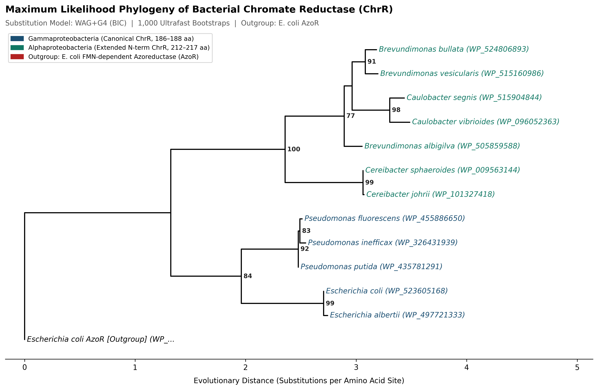

# Evolutionary Phylogeny of Bacterial Chromate Reductase (ChrR)

## Overview
An automated, reproducible computational phylogenetics pipeline investigating the evolutionary divergence and structural conservation of bacterial **Chromate Reductase (ChrR)**—a key flavin mononucleotide (FMN)-dependent oxidoreductase responsible for enzymatic reduction of toxic hexavalent chromium ($Cr^{6+}$) to insoluble trivalent chromium ($Cr^{3+}$).

## Pipeline & Methods
1. **Automated Sequence Curation (`Biopython / NCBI Entrez`):** Retrieved taxon-balanced RefSeq protein sequences (`186–217 aa`) across representative **Gammaproteobacteria** (*Pseudomonas*, *Escherichia*) and **Alphaproteobacteria** (*Brevundimonas*, *Caulobacter*, *Cereibacter*), rooted with *E. coli* FMN-dependent NADH-azoreductase (`AzoR`, `WP_525205575`) as a homologous flavodoxin-like outgroup.
2. **Multiple Sequence Alignment (`MAFFT v7.505`):** Performed iterative L-INS-i alignment (`--auto`) to map conserved catalytic residues and class-specific domain architecture.
3. **Maximum Likelihood Inference (`IQ-TREE 2`):** Evaluated empirical amino acid substitution models via ModelFinder Plus (`-m MFP`, selecting **`WAG+G4`** by BIC) and computed branch confidence with **1,000 ultrafast bootstrap replicates** (`-B 1000`).
4. **Hybrid Visualization (`Matplotlib` & `MEGA 12`):** Exported Newick trees (`chrr_ml.treefile`) for cross-verification in MEGA 12 Tree Explorer and generated 300-DPI publication figures.

## Key Biological Findings
* **Deep Class-Level Divergence (100% Bootstrap Support):** *ChrR* sequences segregate cleanly into two major evolutionary clades separating Gammaproteobacteria (`186–188 aa`) from Alphaproteobacteria (`212–217 aa`).
* **Lineage-Specific N-Terminal Domain Extension:** All examined Alphaproteobacterial *ChrR* homologs possess a conserved ~25-amino-acid N-terminal extension absent in canonical Gammaproteobacterial enzymes.
* **Conserved Catalytic Core:** Strict preservation of the FMN-binding signature (`G-S-L-R-K`) and key structural Proline/Glycine turn residues across both classes confirms strong purifying selection on cofactor-mediated electron transfer.

## Repository Contents
* `01_ChrR_Phylogeny.ipynb` — Complete Google Colab Python workflow
* `chrr_curated.fasta` — Curated RefSeq protein sequences
* `chrr_aligned.fasta` — MAFFT multiple sequence alignment
* `chrr_ml.treefile` — Maximum Likelihood Newick tree with bootstrap values
* `chrr_phylogeny_300dpi.png` — High-resolution annotated phylogenetic tree

## Phylogenetic Tree

